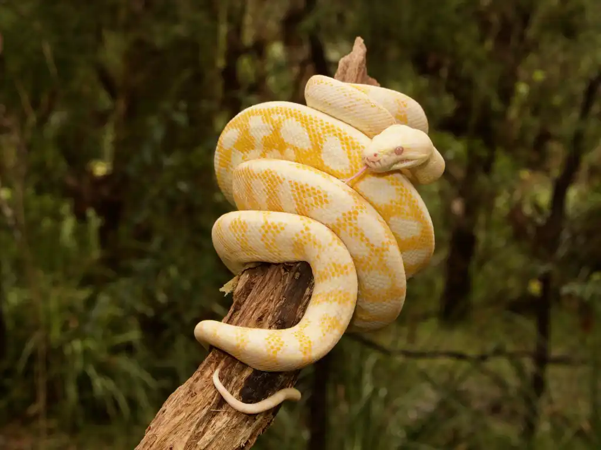

# Hi, I'm Amalia 👋

I'm a Master's student in Life Sciences at the Weizmann Institute of Science.

I really enjoy biology and research, and I'm currently learning how to use computational tools as part of my studies.

## A little about me

I studied Life Sciences at the Hebrew University of Jerusalem, and now I'm continuing to an MSc at Weizmann.

I'm especially interested in understanding how biological systems work at the cellular and molecular level.

During my BSc I worked on identifying interactions between chaperones and their cofactors in yeast!

[My GitHub](https://github.com/amaliawb)
